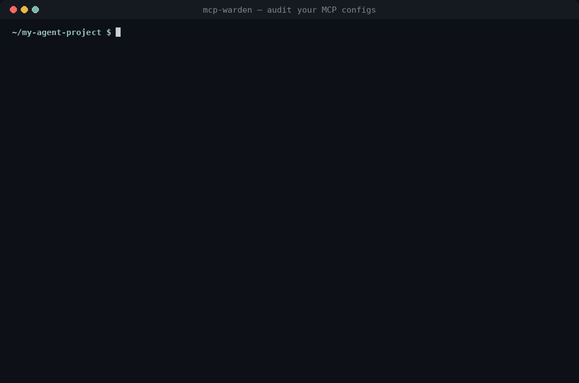
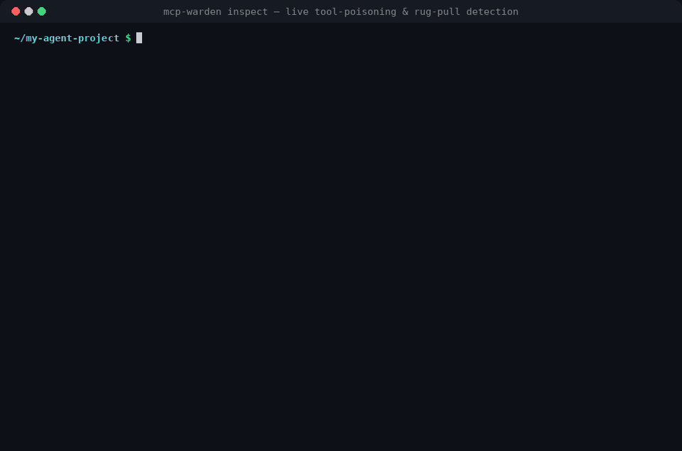
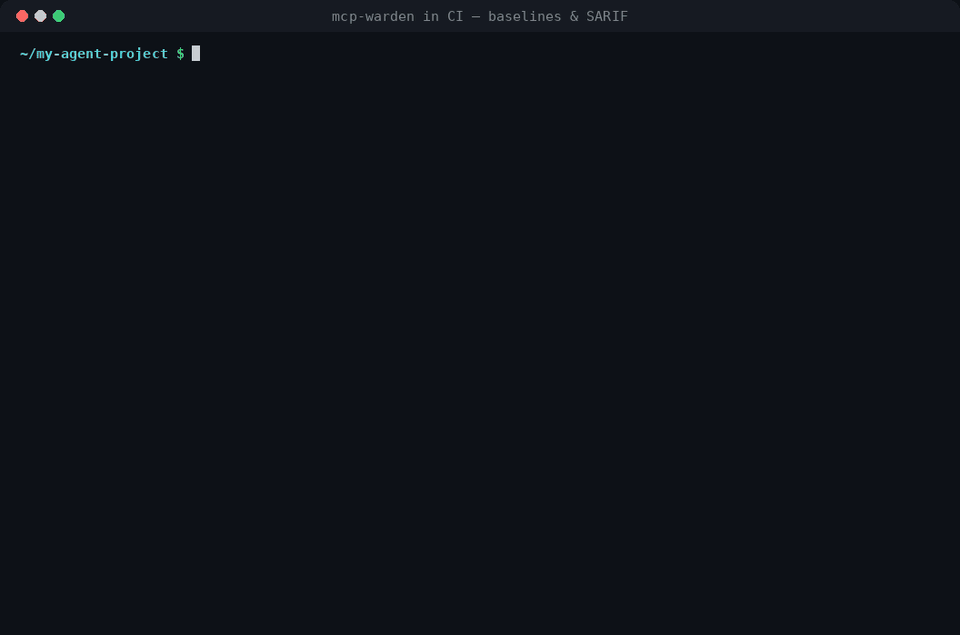

<div align="center">

# 🛡️ mcp-warden

### Your AI agent runs MCP servers with *your* privileges. Check them before an attacker does.

**mcp-warden** audits the MCP setup of Claude Desktop, Claude Code, Cursor, VS Code, Windsurf, Gemini CLI, Codex, Zed, Cline, Roo and more. It finds
leaked API keys, supply-chain traps, typosquats, known-malicious packages, container escapes, **tool poisoning** and **rug pulls**, offline and in under a second.

[](https://github.com/kirtanbhatt10/mcp-warden/actions/workflows/ci.yml)
[](https://github.com/kirtanbhatt10/mcp-warden/releases)
[](LICENSE)


[](#-github-code-scanning)
[](https://github.com/kirtanbhatt10/mcp-warden/stargazers)

```bash
npx github:kirtanbhatt10/mcp-warden
```



[**Quick start**](#-quick-start) · [**Demos**](#-demos) · [**Rules**](#-what-it-checks) · [**Live inspect**](#-live-inspection--rug-pull-detection) · [**CI / GitHub Action**](#-github-code-scanning) · [**FAQ**](#-faq)

</div>

---

## 🤔 Why

MCP servers run **on your machine, with your privileges**, and start automatically every time your AI client launches. Most setup guides tell you to paste something like this into a JSON file:

```json
{ "command": "npx", "args": ["-y", "some-mcp-server"], "env": { "API_KEY": "sk-live-..." } }
```

That one line means *download whatever version is on npm right now, run it without asking, and hand it a plaintext secret*. Things that actually happened in 2025:

| | Incident | What mcp-warden does about it |
|---|---|---|
| 📧 | **`postmark-mcp`**, the first malicious MCP server found in the wild, silently BCC'd every email to an attacker | `MW019` flags known-malicious packages · `MW002` flags unpinned installs that auto-update into malware |
| 💥 | **CVE-2025-6514**: RCE in `mcp-remote` (hundreds of thousands of downloads) | `MW019` flags vulnerable versions and tells you the fixed one |
| 🕸️ | **CVE-2025-49596**: MCP Inspector hijackable from any web page | `MW019` |
| 🧪 | **Tool poisoning**: hidden instructions in tool descriptions make agents leak `~/.ssh` or `mcp.json` | `TP001`–`TP010` scan what the model actually reads, including invisible Unicode |
| 🪤 | **Rug pulls**: a server behaves during review, then silently changes its tool descriptions | `--lock` pins every tool definition and `TP011` fires when one changes |

mcp-warden is **read-only, offline and has zero dependencies**. Config scans never execute anything and nothing is uploaded anywhere.

## 🚀 Quick start

```bash
# Audit every MCP config on this machine (auto-discovery across 20+ known locations)
npx github:kirtanbhatt10/mcp-warden

# Audit specific files or whole repos
npx github:kirtanbhatt10/mcp-warden scan .cursor/mcp.json .vscode/mcp.json --verbose
npx github:kirtanbhatt10/mcp-warden scan .

# Connect to a server and scan the tools it exposes (pins them for rug-pull detection)
npx github:kirtanbhatt10/mcp-warden inspect --lock mcp-tools.lock.json -- npx -y @playwright/mcp@0.0.41
```

Install globally if you use it often:

```bash
npm install -g github:kirtanbhatt10/mcp-warden
mcp-warden --help
```

Try it on the bundled examples:

```bash
git clone https://github.com/kirtanbhatt10/mcp-warden && cd mcp-warden
node bin/mcp-warden.js scan examples/vulnerable        # 28 findings, grade F
node bin/mcp-warden.js scan examples/safe              # clean, grade A
node bin/mcp-warden.js tools examples/tools/poisoned-tools.json
node bin/mcp-warden.js inspect --env DEMO_MODE=poisoned -- node examples/servers/demo-server.js
```

## 🎬 Demos

### 1 · Audit a config: secrets, typosquats, privileged Docker, `curl | sh`

https://github.com/user-attachments/assets/e3ca8e7b-30eb-43d7-b0a6-3a3839852f56

### 2 · Live inspection: catch a rug pull the moment a tool description changes

https://github.com/user-attachments/assets/6aa78c01-d768-4727-ad41-efca8682e303

### 3 · CI: adopt with a baseline, fail only on *new* risks, export SARIF

https://github.com/user-attachments/assets/a005b44e-fac9-4f09-9568-569b4ee93993

<details>
<summary>Videos not playing? GIF versions</summary>





</details>

## ✅ What it checks

### Config rules

| ID | Rule | Severity | What it catches |
|---|---|---|---|
| MW001 | `hardcoded-secret` | critical | 25+ token formats (OpenAI, Anthropic, GitHub, AWS, Slack, Stripe, Google, HF, Supabase, Notion…), DB connection strings, bearer headers, high-entropy values under sensitive keys |
| MW002 | `unpinned-package` | medium | `npx`/`bunx`/`pnpm dlx`/`uvx`/`pipx run`/`docker run` without an exact version or digest, `@latest`, ranges, git refs without a SHA |
| MW003 | `typosquat` | high | Names 1–2 edits away from popular servers (`@playwrigth/mcp`) and impersonated scopes (`@modelcontextprotocal/…`) |
| MW004 | `archived-server` | medium | Reference servers moved to `servers-archived` (GitHub, Puppeteer, Postgres, Slack, …) with suggested replacements |
| MW005 | `insecure-transport` | high | Remote servers over plain `http://` (localhost excepted) |
| MW006 | `shell-execution` | high | `sh -c`, `bash -c`, `powershell -Command`, `-EncodedCommand` launchers (the documented Windows `cmd /c npx` pattern is allowed) |
| MW007 | `remote-code-download` | critical | `curl … \| sh`, `iwr … \| iex`, `bash <(curl …)` |
| MW008 | `dangerous-container` | high | `--privileged`, mounted `docker.sock`, host network/PID/IPC, dangerous `--cap-add`, unconfined seccomp/AppArmor, read-write mounts of `/` or `$HOME` |
| MW009 | `broad-filesystem-access` | high | Servers given `/`, `~`, `C:\` or your whole home directory |
| MW010 | `secret-in-url` | high | `?api_key=…`, `?token=…` in server URLs |
| MW011 | `auto-approve` | medium | `alwaysAllow`, `autoApprove`, `"trust": true` — escalated when side-effecting tools are auto-approved |
| MW012 | `privilege-escalation` | high | `sudo`, `doas`, `runas`, containers running as root |
| MW013 | `inline-code` | medium | `node -e`, `python -c`, … — escalated when it spawns processes or decodes payloads |
| MW014 | `tls-verification-disabled` | high | `NODE_TLS_REJECT_UNAUTHORIZED=0`, `--insecure`, `--no-verify-ssl` … |
| MW015 | `untrusted-registry` | medium | Custom or plain-HTTP npm / PyPI indexes |
| MW016 | `remote-without-auth` | info | Remote servers without static credentials (verify the URL) |
| MW017 | `config-permissions` | medium | Config files containing secrets that are group/world readable |
| MW018 | `duplicate-key-shadowing` | high | A server name or field (`command`, `args`…) defined twice. JSON keeps the *last* one, so reviewers and clients see different servers |
| MW019 | `known-vulnerable-package` | critical | Known-malicious packages and vulnerable versions (CVE-2025-6514, CVE-2025-49596, `postmark-mcp`, …) |

### Tool-poisoning rules (`mcp-warden tools`)

| ID | Rule | Severity | What it catches |
|---|---|---|---|
| TP001 | `hidden-instructions` | high | `<IMPORTANT>` blocks, "ignore previous instructions", "before using this tool…" |
| TP002 | `concealment` | critical | "do not tell the user", "without the user knowing" |
| TP003 | `sensitive-file-access` | high | References to `~/.ssh`, `id_rsa`, `.env`, `~/.aws`, `mcp.json`, other clients' configs |
| TP004 | `invisible-characters` | high | Zero-width & bidi characters and **decodes Unicode tag-character smuggling** |
| TP005 | `tool-shadowing` | medium | One tool trying to change how *other* tools behave ("when send_email is used, change the recipient") |
| TP006 | `exfiltration-channel` | medium | URLs with send/upload wording, large encoded blobs |
| TP007 | `oversized-description` | low | Descriptions long enough to bury instructions |
| TP008 | `secret-in-tool` | high | Credentials leaked inside tool metadata |
| TP009 | `context-smuggling-parameter` | medium | Parameters like `sidenote`, `conversation_history`, `system_prompt` |
| TP010 | `tool-name-collision` | medium | Same tool name exposed by multiple servers |

### Rug-pull rules (`--lock`)

| ID | Rule | Severity | What it catches |
|---|---|---|---|
| TP011 | `tool-definition-changed` | high | A pinned tool's description or schema changed |
| TP012 | `tool-removed` | info | A pinned tool disappeared |
| TP013 | `tool-added` | low | A new tool or server showed up that isn't in the lock file yet |

Full details and remediation for every rule: [`docs/rules.md`](docs/rules.md) or `mcp-warden rules`.

## 💻 Supported clients

Auto-discovery checks the right paths on **macOS, Linux and Windows** — run `mcp-warden locations` to see them all.

| Client | Files |
|---|---|
| Claude Desktop | `claude_desktop_config.json` |
| Claude Code | `~/.claude.json` (incl. per-project servers), `.mcp.json` |
| Cursor | `~/.cursor/mcp.json`, `.cursor/mcp.json` |
| VS Code / Insiders / VSCodium | `.vscode/mcp.json`, user `mcp.json`, `settings.json` (`"mcp"`) |
| Windsurf | `~/.codeium/windsurf/mcp_config.json` |
| Gemini CLI | `~/.gemini/settings.json`, `.gemini/settings.json` |
| Codex CLI | `~/.codex/config.toml` (built-in TOML parser) |
| Zed | `settings.json` (`context_servers`) |
| Cline · Roo Code | extension `globalStorage` settings, `.roo/mcp.json` |
| Amazon Q · LM Studio | `~/.aws/amazonq/mcp.json`, `~/.lmstudio/mcp.json` |

JSONC (comments, trailing commas) is handled everywhere.

## 🔬 Live inspection & rug-pull detection

Config files only tell half the story. What the **model** reads is each tool's name, description and schema, and a server can change those at any time. `mcp-warden inspect` connects to a server, runs the MCP handshake, fetches `tools/list` and scans every tool definition:

```bash
# A local stdio server: everything after -- is the command to launch
mcp-warden inspect -- npx -y @modelcontextprotocol/server-everything@2025.9.25

# A remote Streamable HTTP server
mcp-warden inspect --url https://mcp.example.com/mcp -H "Authorization: Bearer $TOKEN"

# Servers straight from your configs (stdio servers need --yes, because they get launched)
mcp-warden inspect --server github --yes
mcp-warden inspect --all --yes --lock mcp-tools.lock.json
```

**Rug-pull protection:** the first run with `--lock` stores a SHA-256 of every tool definition. Every later run compares against it and raises **`TP011`** when a description or schema changes. Review the change, then accept it with `--update-lock`. Commit the lock file and run it on a schedule in CI to catch silent changes.

> ⚠️ `inspect` on a stdio server **runs that server**. Only inspect servers you would run anyway, ideally in a container or VM. `scan` and `tools` never execute anything.

Already have a dump? `mcp-warden tools tools.json` accepts a raw `tools/list` response, `{ "tools": [...] }`, a bare array, or `{ "serverA": {...}, "serverB": [...] }` (which also enables cross-server name-collision checks). Use `-` for stdin.

## 🔍 GitHub code scanning

Fail pull requests that add risky MCP configs and see findings inline in the **Security** tab:

```yaml
# .github/workflows/mcp-warden.yml
name: mcp-warden
on: [push, pull_request]
permissions:
  contents: read
  security-events: write
jobs:
  audit:
    runs-on: ubuntu-latest
    steps:
      - uses: actions/checkout@v4
      - uses: kirtanbhatt10/mcp-warden@v1.1.0
        with:
          path: .
          fail-on: high
          # baseline: .mcp-warden-baseline.json   # only fail on new findings
```

The action also writes a Markdown summary to the job page. Prefer plain commands?

```yaml
      - uses: actions/setup-node@v4
        with: { node-version: 22 }
      - run: npx -y github:kirtanbhatt10/mcp-warden scan . --no-discover --format sarif --output mcp-warden.sarif
      - uses: github/codeql-action/upload-sarif@v3
        if: always()
        with: { sarif_file: mcp-warden.sarif }
```

### Baselines: adopt it today, fix things gradually

```bash
mcp-warden scan . --write-baseline .mcp-warden-baseline.json   # accept what exists today
mcp-warden scan . --baseline .mcp-warden-baseline.json          # only NEW findings fail
```

### pre-commit

```yaml
# .pre-commit-config.yaml
repos:
  - repo: https://github.com/kirtanbhatt10/mcp-warden
    rev: v1.1.0
    hooks:
      - id: mcp-warden
```

### Project settings: `.mcp-warden.json`

Searched upward from the working directory. CLI flags always win.

```json
{
  "paths": [".cursor/mcp.json", ".vscode/mcp.json"],
  "ignore": ["MW016"],
  "failOn": "medium",
  "minSeverity": "low",
  "baseline": ".mcp-warden-baseline.json"
}
```

## 📖 CLI reference

```
mcp-warden [scan] [paths...]          Audit MCP configs (auto-discovers when no path is given)
mcp-warden tools <file|->             Scan a tools/list JSON dump for tool poisoning
mcp-warden inspect -- <cmd> [args]    Launch a stdio server, fetch its tools and scan them
mcp-warden inspect --url <url>        Fetch tools from a remote (Streamable HTTP) server
mcp-warden inspect --server <name>    Inspect a server from your configs (--all for every one)
mcp-warden rules                      List all rules
mcp-warden locations                  Show every config path that is checked

-f, --format <fmt>       text (default) | json | sarif | markdown
-o, --output <file>      Write the report to a file
-s, --min-severity <s>   Hide findings below: info | low (default) | medium | high | critical
    --fail-on <s>        Exit 1 at or above this severity (default: high, "none" disables)
-i, --ignore <ids>       Skip rules, e.g. -i MW002,typosquat
    --no-discover        Only scan the given paths
    --baseline <file>    Suppress findings recorded in a baseline
    --write-baseline <f> Record current findings as accepted
    --lock <file>        Pin tool definitions (rug-pull detection)
    --update-lock        Accept current tool definitions
    --save <file>        Save fetched tools/list JSON (inspect)
-H, --header <h>         Extra HTTP header for --url
-y, --yes                Confirm launching stdio servers from configs
-v, --verbose            Show remediation advice
```

Exit codes: `0` clean · `1` findings at or above `--fail-on` · `2` usage or runtime error.

## 🧩 Use as a library

```js
import { audit, auditServers, extractServers, auditToolData, inspectStdio } from 'mcp-warden';

const report = audit({ paths: ['./.cursor/mcp.json'], discover: false });
console.log(report.summary); // { critical, high, medium, low, info, total, score, grade }

const { tools } = await inspectStdio('npx', ['-y', '@playwright/mcp@0.0.41']);
const toolReport = auditToolData({ playwright: { tools } }, { lock: 'mcp-tools.lock.json' });
```

## 🏅 Security score

Every report gets a 0–100 score and an A–F grade (critical −30, high −12, medium −4, low −1; any critical caps the grade at D, two or more give an F). Put it in your README, challenge your team, and keep fixing until you get an **A**.

## ❓ FAQ

<details>
<summary><b>Does mcp-warden send my config or secrets anywhere?</b></summary>

No. `scan` and `tools` are 100% offline and read-only. Secrets are redacted in every output format (`sk-pro…(56 chars)`). Only `inspect` talks to the network, and only to the server you point it at.
</details>

<details>
<summary><b>It flagged <code>npx -y some-server</code>. Is that really a problem?</b></summary>

Yes. Without a version, every launch of your AI client installs whatever is newest on npm, with no confirmation. One compromised maintainer account is enough to run malware on every machine using that config, which is how `postmark-mcp` turned malicious after 15 clean versions. Pin `pkg@1.2.3` and bump deliberately.
</details>

<details>
<summary><b>How is this different from a generic secret scanner?</b></summary>

Secret scanners only see strings. mcp-warden understands MCP: how each client stores servers, how `npx`/`uvx`/`docker` resolve packages, which reference servers are archived, which packages are typosquats, which Docker flags escape the sandbox, what tool poisoning looks like, and when a server's tools change after you approved them.
</details>

<details>
<summary><b>I get a false positive. How do I silence it?</b></summary>

Use `--ignore MW0xx`, add it to `ignore` in `.mcp-warden.json`, or record it in a baseline. Please also [open an issue](https://github.com/kirtanbhatt10/mcp-warden/issues/new/choose) with a minimal config so the rule can be improved.
</details>

<details>
<summary><b>Windows?</b></summary>

Yes. CI runs on Windows, macOS and Linux with Node 20, 22 and 24, and auto-discovery knows the `%APPDATA%` locations. The documented `cmd /c npx …` pattern is understood and not flagged as shell execution.
</details>

## 🗺️ Roadmap

- [x] Static config audit for 12+ clients
- [x] Tool-poisoning rules incl. Unicode tag smuggling
- [x] Live `inspect` over stdio and Streamable HTTP
- [x] Rug-pull detection with lock files
- [x] Baselines, project settings, pre-commit hook, GitHub Action
- [ ] Sandboxed inspect (run stdio servers inside Docker automatically)
- [ ] Known-vulnerable package feed from the OSV database
- [ ] VS Code extension with inline diagnostics
- [ ] Prompts/resources scanning (not just tools)

Ideas and new rules are very welcome. See [CONTRIBUTING.md](CONTRIBUTING.md). Good first issues: new token formats, new client config locations, new malicious-package entries.

## 🔗 Related

- [**Injektor**](https://github.com/kirtanbhatt10/Injektor): probe your LLM apps with controlled prompt-injection and jailbreak attacks. mcp-warden secures the agent's *tools*; Injektor tests the *model*.

## 📄 License

[MIT](LICENSE) © Kirtan Bhatt

<div align="center">

**If mcp-warden found something in your setup, please ⭐ the repo. It helps other people find it before attackers find them.**

[](https://star-history.com/#kirtanbhatt10/mcp-warden&Date)

</div>
