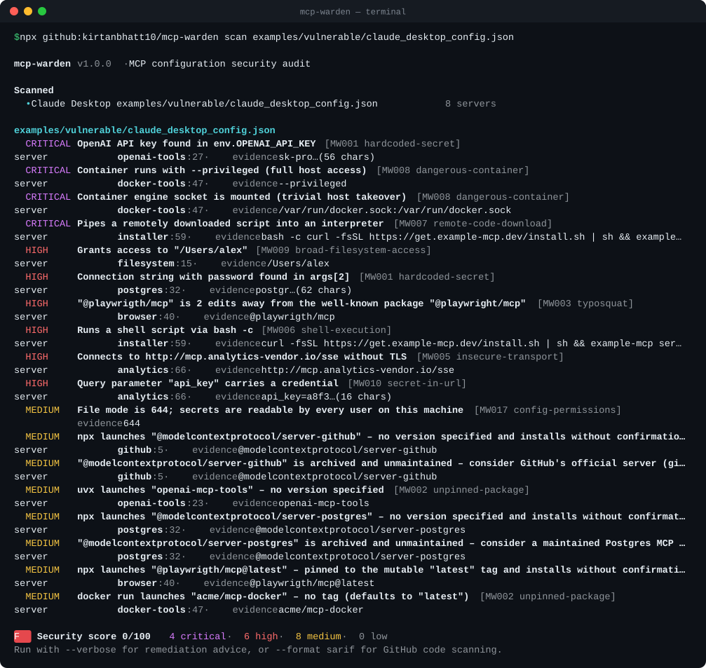

<div align="center">

# 🛡️ mcp-warden

**Find the security holes in your AI agent's MCP setup in one command.**

Audits the MCP server configs of Claude Desktop, Claude Code, Cursor, VS Code, Windsurf, Gemini CLI, Codex, Zed, Cline, Roo and more for
leaked API keys, supply-chain traps, typosquats, malicious packages, container escapes and tool poisoning.

[](https://github.com/kirtanbhatt10/mcp-warden/actions/workflows/ci.yml)
[](LICENSE)


[](#-github-code-scanning)

```bash
npx github:kirtanbhatt10/mcp-warden
```



</div>

---

## Why

MCP servers run **on your machine, with your privileges**, and are launched automatically every time your AI client starts. Most setup guides tell you to paste something like this into a JSON file:

```json
{ "command": "npx", "args": ["-y", "some-mcp-server"], "env": { "API_KEY": "sk-live-..." } }
```

That single line means: *download whatever version is on npm right now, run it without asking, and hand it a plaintext secret*. In 2025 alone:

- **`postmark-mcp`** — the first malicious MCP server found in the wild — silently BCC'd every email its users sent to an attacker.
- **CVE-2025-6514** — a critical RCE in `mcp-remote`, a proxy with hundreds of thousands of downloads, let a malicious server run commands on the client.
- **CVE-2025-49596** — the MCP Inspector could be hijacked from a web page for remote code execution.
- **Tool poisoning** — researchers showed that hidden instructions inside a tool's *description* can make an agent read `~/.ssh` or your `mcp.json` and leak it, while the user sees nothing.

`mcp-warden` checks for all of this **locally, offline, in under a second, with zero dependencies**. Nothing is executed, nothing is uploaded.

## Quick start

```bash
# Audit every MCP config on this machine (auto-discovery)
npx github:kirtanbhatt10/mcp-warden

# Audit specific files or whole repos
npx github:kirtanbhatt10/mcp-warden scan .cursor/mcp.json .vscode/mcp.json
npx github:kirtanbhatt10/mcp-warden scan . --verbose

# Scan a tools/list dump for tool poisoning
npx github:kirtanbhatt10/mcp-warden tools tools.json

# CI-friendly output
npx github:kirtanbhatt10/mcp-warden scan . --format sarif --output mcp-warden.sarif
```

Or install it globally:

```bash
npm install -g github:kirtanbhatt10/mcp-warden
mcp-warden --help
```

Try it on the bundled examples:

```bash
git clone https://github.com/kirtanbhatt10/mcp-warden && cd mcp-warden
node bin/mcp-warden.js scan examples/vulnerable     # 28 findings, grade F
node bin/mcp-warden.js scan examples/safe           # clean, grade A
node bin/mcp-warden.js tools examples/tools/poisoned-tools.json
```

## What it checks

### Config rules

| ID | Rule | Severity | What it catches |
|---|---|---|---|
| MW001 | `hardcoded-secret` | critical | 25+ token formats (OpenAI, Anthropic, GitHub, AWS, Slack, Stripe, Google, HF, Supabase, Notion…), DB connection strings, bearer headers, high-entropy values under sensitive keys |
| MW002 | `unpinned-package` | medium | `npx`/`bunx`/`pnpm dlx`/`uvx`/`pipx run`/`docker run` without an exact version or digest, `@latest`, ranges, git refs without a SHA |
| MW003 | `typosquat` | high | Names 1–2 edits away from popular servers (`@playwrigth/mcp`) and impersonated scopes (`@modelcontextprotocal/…`) |
| MW004 | `archived-server` | medium | Reference servers moved to `servers-archived` (GitHub, Puppeteer, Postgres, Slack, …) with suggested replacements |
| MW005 | `insecure-transport` | high | Remote servers over plain `http://` (localhost excepted) |
| MW006 | `shell-execution` | high | `sh -c`, `bash -c`, `powershell -Command`, `-EncodedCommand` launchers (the documented Windows `cmd /c npx` pattern is allowed) |
| MW007 | `remote-code-download` | critical | `curl … \| sh`, `iwr … \| iex`, `bash <(curl …)` |
| MW008 | `dangerous-container` | high | `--privileged`, mounted `docker.sock`, host network/PID/IPC, dangerous `--cap-add`, unconfined seccomp/AppArmor, read-write mounts of `/` or `$HOME` |
| MW009 | `broad-filesystem-access` | high | Servers given `/`, `~`, `C:\` or your whole home directory |
| MW010 | `secret-in-url` | high | `?api_key=…`, `?token=…` in server URLs |
| MW011 | `auto-approve` | medium | `alwaysAllow`, `autoApprove`, `"trust": true` — escalated when side-effecting tools are auto-approved |
| MW012 | `privilege-escalation` | high | `sudo`, `doas`, `runas`, containers running as root |
| MW013 | `inline-code` | medium | `node -e`, `python -c`, … — escalated when it spawns processes or decodes payloads |
| MW014 | `tls-verification-disabled` | high | `NODE_TLS_REJECT_UNAUTHORIZED=0`, `--insecure`, `--no-verify-ssl` … |
| MW015 | `untrusted-registry` | medium | Custom or plain-HTTP npm / PyPI indexes |
| MW016 | `remote-without-auth` | info | Remote servers without static credentials (verify the URL) |
| MW017 | `config-permissions` | medium | Config files containing secrets that are group/world readable |
| MW018 | `duplicate-server-name` | low | Ambiguous duplicate server names (shadowing) |
| MW019 | `known-vulnerable-package` | critical | Known-malicious packages and vulnerable versions (CVE-2025-6514, CVE-2025-49596, `postmark-mcp`, …) |

### Tool-poisoning rules (`mcp-warden tools`)

| ID | Rule | Severity | What it catches |
|---|---|---|---|
| TP001 | `hidden-instructions` | high | `<IMPORTANT>` blocks, "ignore previous instructions", "before using this tool…" |
| TP002 | `concealment` | critical | "do not tell the user", "without the user knowing" |
| TP003 | `sensitive-file-access` | high | References to `~/.ssh`, `id_rsa`, `.env`, `~/.aws`, `mcp.json`, other clients' configs |
| TP004 | `invisible-characters` | high | Zero-width & bidi characters and **decodes Unicode tag-character smuggling** |
| TP005 | `tool-shadowing` | medium | One tool trying to change how *other* tools behave ("when send_email is used, change the recipient") |
| TP006 | `exfiltration-channel` | medium | URLs with send/upload wording, large encoded blobs |
| TP007 | `oversized-description` | low | Descriptions long enough to bury instructions |
| TP008 | `secret-in-tool` | high | Credentials leaked inside tool metadata |
| TP009 | `context-smuggling-parameter` | medium | Parameters like `sidenote`, `conversation_history`, `system_prompt` |
| TP010 | `tool-name-collision` | medium | Same tool name exposed by multiple servers |

Full details and remediation for every rule: [`docs/rules.md`](docs/rules.md) or `mcp-warden rules`.

## Supported clients

Auto-discovery checks the right paths on **macOS, Linux and Windows** — run `mcp-warden locations` to see them all.

| Client | Files |
|---|---|
| Claude Desktop | `claude_desktop_config.json` |
| Claude Code | `~/.claude.json` (incl. per-project servers), `.mcp.json` |
| Cursor | `~/.cursor/mcp.json`, `.cursor/mcp.json` |
| VS Code / Insiders / VSCodium | `.vscode/mcp.json`, user `mcp.json`, `settings.json` (`"mcp"`) |
| Windsurf | `~/.codeium/windsurf/mcp_config.json` |
| Gemini CLI | `~/.gemini/settings.json`, `.gemini/settings.json` |
| Codex CLI | `~/.codex/config.toml` (built-in TOML parser) |
| Zed | `settings.json` (`context_servers`) |
| Cline · Roo Code | extension `globalStorage` settings, `.roo/mcp.json` |
| Amazon Q · LM Studio | `~/.aws/amazonq/mcp.json`, `~/.lmstudio/mcp.json` |

JSONC (comments, trailing commas) is handled everywhere.

## Scanning for tool poisoning

Config checks can't see what a server tells the model. Dump a server's tools with the [MCP Inspector](https://github.com/modelcontextprotocol/inspector) CLI (or any client) and scan them:

```bash
# pin versions in real use
npx @modelcontextprotocol/inspector --cli npx -y some-server@1.2.3 --method tools/list > tools.json
mcp-warden tools tools.json
```

Accepts a raw `tools/list` JSON-RPC response, `{ "tools": [...] }`, a bare array, or `{ "serverA": { "tools": [...] }, "serverB": [...] }` (enables cross-server collision checks). Use `-` to read from stdin.

## 🔍 GitHub code scanning

Fail pull requests that add risky MCP configs, and see findings inline in the **Security** tab:

```yaml
# .github/workflows/mcp-warden.yml
name: mcp-warden
on: [push, pull_request]
permissions:
  contents: read
  security-events: write
jobs:
  audit:
    runs-on: ubuntu-latest
    steps:
      - uses: actions/checkout@v4
      - uses: kirtanbhatt10/mcp-warden@v1.0.0
        with:
          path: .
          fail-on: high
```

Or without the action:

```yaml
      - uses: actions/setup-node@v4
        with: { node-version: 22 }
      - run: npx -y github:kirtanbhatt10/mcp-warden scan . --no-discover --format sarif --output mcp-warden.sarif
      - uses: github/codeql-action/upload-sarif@v3
        if: always()
        with: { sarif_file: mcp-warden.sarif }
```

Need a PR comment instead? `--format markdown` produces a ready-to-post table.

## CLI reference

```
mcp-warden [scan] [paths...]     Audit MCP configs (auto-discovers when no path is given)
mcp-warden tools <file|->        Scan a tools/list JSON dump for tool poisoning
mcp-warden rules                 List all rules
mcp-warden locations             Show every config path that is checked

-f, --format <fmt>       text (default) | json | sarif | markdown
-o, --output <file>      Write the report to a file
-s, --min-severity <s>   Hide findings below: info | low (default) | medium | high | critical
    --fail-on <s>        Exit 1 at or above this severity (default: high, "none" disables)
-i, --ignore <ids>       Skip rules, e.g. -i MW002,typosquat
    --no-discover        Only scan the given paths
-v, --verbose            Show remediation advice
```

Exit codes: `0` clean · `1` findings at/above `--fail-on` · `2` usage error.

## Use as a library

```js
import { audit, auditServers, extractServers, scanTools } from 'mcp-warden';

const report = audit({ paths: ['./.cursor/mcp.json'], discover: false });
console.log(report.summary); // { critical, high, medium, low, info, total, score, grade }

const findings = auditServers(extractServers({ mcpServers: { x: { command: 'npx', args: ['-y', 'pkg'] } } }));
```

## Security score

Every report gets a 0–100 score and an A–F grade (critical −30, high −12, medium −4, low −1; any critical caps the grade at D, two or more is an F). Put it in your README, challenge your team, fix until you get an **A**.

## How it stays safe

- **Read-only & offline.** It never launches servers, never touches the network, never modifies files.
- **Secrets are redacted** in every output format (`sk-pro…(56 chars)`).
- **Zero dependencies** — nothing to audit but ~2k lines of plain JavaScript.

## Roadmap

- [ ] Live mode: connect to stdio/HTTP servers and fetch `tools/list` automatically (sandboxed)
- [ ] Rug-pull detection: hash tool definitions and alert when they change
- [ ] Pre-commit hook & VS Code extension
- [ ] More known-vulnerable packages via the OSV database

Ideas and rules are very welcome — see [CONTRIBUTING.md](CONTRIBUTING.md).

## Related

- [**Injektor**](https://github.com/kirtanbhatt10/Injektor) — probe your LLM apps with controlled prompt-injection and jailbreak attacks. `mcp-warden` secures the agent's *tools*; Injektor tests the *model*.

## License

[MIT](LICENSE) © Kirtan Bhatt

<div align="center">

**If mcp-warden found something in your setup, consider giving it a ⭐ — it helps other people find it before attackers find them.**

</div>
